# 🎬 Awesome VFX & Motion Graphics Generation 🚀

 

 

### *The Definitive Curated Directory of SaaS Suites & Open-Source Repositories for Visual Effects, Procedural Motion Design & Generative Video VFX*

**Focused on Node-Based Compositing, Programmatic Motion Graphics, Generative AI VFX, 3D Visual Effects, Rotoscoping, Neural Matting & Real-Time Shaders** 🌟

*Last updated: November 2026*

---

## 🧭 Table of Contents

- [🌟 Overview & SEO Summary](#-overview--seo-summary)
- [📊 Sector Overview & Market Dynamics](#-sector-overview--market-dynamics)
- [💼 Commercial & SaaS Platforms](#-commercial--saas-platforms)
- [💻 Open-Source GitHub Projects](#-open-source-github-projects)
- [📈 Star History](#-star-history)
- [🤝 How to Contribute](#-how-to-contribute)
- [💖 Support & Sponsorship](#-support--sponsorship)
- [📄 License & Disclaimer](#-license--disclaimer)

---

## 🌟 Overview & SEO Summary

Welcome to the ultimate directory for **VFX (Visual Effects)** and **Motion Graphics Generation**. Whether you are a professional VFX compositor working on feature films, a motion designer crafting branded UI animations, or an AI engineer developing next-generation video diffusion models, this collection tracks the best software, frameworks, and libraries.

### 🔍 Key Technology Domains
- 🎞️ **Node-Based Compositing**: Multi-layer EXR pipelines, deep compositing, planar tracking, and OFX plugin ecosystems.
- 📐 **Programmatic Motion Graphics**: Code-driven vector animation, React video composition, mathematical explainer graphics, and WebAssembly rendering.
- 🤖 **Generative AI VFX & Video Synthesis**: Diffusion transformers, multi-motion brush controls, video-to-video restyling, and relighting.
- ✂️ **Neural Rotoscoping & Video Matting**: High-resolution foreground alpha extraction, SAM 2 promptable segmentation, and temporally coherent matte generation.
- 🧹 **Video Inpainting & Object Removal**: Flow-guided rig removal, wire cleanup, watermark replacement, and spatio-temporal background hallucination.
- 🧊 **3D Simulation & Real-Time Shaders**: 3D Gaussian Splatting, NeRF studios, geometry nodes, and particle physics engines.

---

## 📊 Sector Overview & Market Dynamics

The global visual effects (VFX) and motion graphics software market is estimated at approximately **$12.5 billion in 2024**, projected to reach **$24.8 billion by 2030** at an annual growth rate (CAGR) of ~11.8%, accelerated by generative AI video integration, cloud-native collaborative pipelines, and real-time virtual production.

The industry displays a **moderately fragmented, dual-tier structure**: Hollywood studio workflows and professional enterprise NLE suites remain concentrated around entrenched incumbents (Adobe, Foundry, Blackmagic Design, Maxon), while generative AI video synthesis, code-driven web motion graphics, and neural rotoscoping are rapidly democratizing the sector through highly specialized, venture-backed startups and high-velocity open-source ecosystems.

---

## 💼 Commercial & SaaS Platforms

The table below lists the top commercial suites, creative clouds, and AI SaaS generation engines, sorted in descending order by estimated company valuation / annual revenue:

| 🏢 Platform | 💰 Company Valuation / Revenue | 🏷️ Starting Tier Pricing | 🎁 Free Tier Limit / Trial | 🛠️ Key VFX & Motion Capabilities |
| :--- | :--- | :--- | :--- | :--- |
| **[Adobe After Effects](https://adobe.com)** 🎨 | ~$215 Billion Market Cap / $21B+ Rev | $22.99 / month (Single App plan) | 7-day free trial (Full unrestricted access to all native tools) | Industry-standard timeline motion design, keyframe animation, 3D workspace, and Roto Brush AI. |
| **[Runway](https://runwayml.com)** 🤖 | ~$4.0 Billion Valuation | $15.00 / month ($12/mo billed annually) | Free forever plan with 125 one-time credits, 3 video projects, and 720p exports | Cloud generative AI video (Gen-3 Alpha / Gen-4), Multi-Motion Brush, green screen rotoscoping, and inpainting. |
| **[Blackmagic Fusion Studio](https://blackmagicdesign.com)** 🎥 | ~$600 Million Annual Revenue | $295.00 one-time perpetual license | Free forever plan via DaVinci Resolve (Full 2D/3D compositing up to Ultra HD 3840x2160) | High-end node-based 2D/3D compositing, volumetric effects, planar tracking, and deep color management. |
| **[Maxon One](https://maxon.net)** ⚡ | ~$350 Million Valuation | $149.00 / month ($1,199/yr billed annually) | 14-day free trial (Complete access across Cinema 4D, Red Giant, Trapcode, and ZBrush) | Procedural 3D motion graphics (MoGraph), Redshift GPU rendering, Trapcode particle simulation, and Magic Bullet color grading. |
| **[Foundry Nuke](https://foundry.com)** 🎞️ | ~$300 Million Valuation | $3,599.00 perpetual license (or $1,099/yr rental) | Free forever non-commercial license (watermark-free 1080p, non-commercial educational use) | Academy Award-winning node compositor for feature films, deep compositing, CopyCat ML, and 3D camera tracker. |
| **[Boris FX Suite](https://borisfx.com)** 🔮 | ~$100 Million Valuation | $195.00 / month ($1,295/yr billed annually) | 14-day free trial (Fully functional trial with temporary watermark on rendering) | Flagship VFX plugin collection including Sapphire lighting/flares, Mocha Pro planar tracking, and Continuum filters. |
| **[Topaz Video AI](https://topazlabs.com)** 🔍 | ~$80 Million Valuation | $299.00 one-time perpetual purchase | Free trial with no time limit (Processes full videos with watermarked preview exports) | Neural upscaling up to 8K/16K, motion-deblurring, frame rate interpolation (120fps+), and optical-flow slow motion. |
| **[Kling AI](https://klingai.com)** 🚀 | ~$70 Million Est. Run-Rate | $10.00 / month (Standard Tier, 660 monthly credits) | Free forever plan with 66 daily credits replenished every 24 hours | 1080p cinematic generative video, camera trajectory motion presets, and multi-element character control. |
| **[Luma AI](https://lumalabs.ai)** ✨ | ~$60 Million Valuation | $9.99 / month (Lite Tier, 1,200 monthly credits) | Free forever plan with 30 monthly credits (~3-4 generations per month) | Dream Machine generative video, keyframe morphing, camera path controls, and Modify Video restyling. |
| **[Pika Labs](https://pika.art)** 🎭 | ~$50 Million Valuation | $10.00 / month ($8/mo billed annually, 700 monthly credits) | Free forever plan with 150 non-replenishing initial credits + 30 daily credits | Pikaffects physical transformations (explode, melt, squish), regional video inpainting, and audio synchronization. |
| **[Rive](https://rive.app)** 🎮 | ~$40 Million Valuation | $24.00 / editor / month (billed annually at $288/yr) | Free forever plan with up to 3 public files and unlimited view-only community links | Interactive real-time motion graphics, visual state machines, bone rigging, and sub-millisecond runtime execution. |
| **[Jitter](https://jitter.video)** 🖌️ | ~$15 Million Valuation | $12.00 / month ($9/mo billed annually) | Free forever plan with unlimited 720p exports (includes subtle Jitter watermark) | Collaborative browser-based motion design editor for UI micro-interactions, kinetic text, and Lottie export. |

---

## 💻 Open-Source GitHub Projects

The following table indexes leading open-source repositories for VFX compositing, code-driven motion design, procedural animation, neural rotoscoping, and generative video AI. Repositories are strictly sorted in descending order by verified GitHub stargazers count:

| 📦 Repository & Name | ⭐ Stargazers Count | 🏷️ Primary Category | 📝 Description & Technical Focus |
| :--- | :--- | :--- | :--- |
| **[ComfyUI](https://github.com/Comfy-Org/ComfyUI)** 🧠 |  | Generative AI VFX | The most powerful and modular diffusion model GUI and node-graph backend for procedural video VFX, ControlNet, and relighting. |
| **[Three.js](https://github.com/mrdoob/three.js)** 🌐 |  | 3D Web VFX Engine | Premier JavaScript 3D engine enabling real-time WebGL/WebGPU shaders, post-processing visual effects, and particle choreography. |
| **[Manim (3Blue1Brown)](https://github.com/3b1b/manim)** 📐 |  | Code Motion Graphics | Animation engine for explanatory mathematical videos, programmatic kinetic motion, and geometric transformations. |
| **[Remotion](https://github.com/remotion-dev/remotion)** ⚛️ |  | Programmatic Motion | Flagship framework for creating programmatic motion graphics, dynamic typography, and data-driven video with React and CSS. |
| **[PixiJS](https://github.com/pixijs/pixijs)** ⚡ |  | 2D WebGL Shaders | High-performance 2D WebGL/WebGPU rendering engine for real-time visual effects, filter pipelines, and interactive canvas graphics. |
| **[Manim Community](https://github.com/ManimCommunity/manim)** 🐍 |  | Code Motion Graphics | Community-maintained Python framework for procedural vector animation, math explainers, and precision audio-visual sync. |
| **[React Three Fiber](https://github.com/pmndrs/react-three-fiber)** 🪄 |  | 3D React Graphics | Declarative React renderer for Three.js powering modern interactive 3D motion graphics, camera controls, and volumetric shaders. |
| **[GSAP](https://github.com/greensock/GSAP)** 🟢 |  | Web Motion Animation | Industry-standard JavaScript animation platform featuring timeline control, MorphSVG, and ScrollTrigger for browser motion design. |
| **[Taichi](https://github.com/taichi-dev/taichi)** 🌊 |  | Physics Simulation | Productive GPU programming language in Python for high-performance fluid dynamics, smoke, soft-body, and particle VFX simulations. |
| **[3D Gaussian Splatting](https://github.com/graphdeco-inria/gaussian-splatting)** 🔮 |  | Neural 3D VFX | Groundbreaking reference implementation of 3D Gaussian Splatting for real-time radiance field rendering and camera match-moving. |
| **[Blender](https://github.com/blender/blender)** 🍊 |  | 3D Suite & VFX | Complete 3D creation pipeline: Geometry Nodes procedural motion, Cycles/EEVEE rendering, camera tracking, and node compositing. |
| **[SAM 2 (Segment Anything 2)](https://github.com/facebookresearch/sam2)** 🎯 |  | Neural Rotoscoping | Meta's foundation model for real-time promptable visual segmentation and automated AI rotoscoping across complex video frames. |
| **[Motion Canvas](https://github.com/motion-canvas/motion-canvas)** 🎨 |  | Code Motion Graphics | TypeScript library and browser timeline editor for authoring procedural vector motion graphics and synchronized animations in code. |
| **[Wan2.1](https://github.com/Wan-Video/Wan2.1)** 🌌 |  | Generative Video AI | Advanced open-weight foundation video model with VACE for unified video VFX inpainting, outpainting, and motion transfer. |
| **[Open3D](https://github.com/isl-org/Open3D)** 🧊 |  | 3D Data Processing | Modern C++ and Python library for 3D point cloud reconstruction, mesh processing, surface alignment, and visual scene analysis. |
| **[Meshroom](https://github.com/alicevision/Meshroom)** 📷 |  | 3D Photogrammetry | Node-based visual programming toolbox and 3D photogrammetry pipeline for VFX environment scans and asset reconstruction. |
| **[Nerfstudio](https://github.com/nerfstudio-project/nerfstudio)** 🕶️ |  | Neural Radiance Fields | Modular end-to-end framework for training, visualizing, and exporting NeRFs and Gaussian Splats into film VFX workflows. |
| **[Robust Video Matting (RVM)](https://github.com/PeterL1n/RobustVideoMatting)** ✂️ |  | Neural Video Matting | Real-time neural green-screen replacement and alpha matting designed for clean hair, fine edges, and motion blur handling. |
| **[Olive Video Editor](https://github.com/olive-editor/olive)** 🫒 |  | Node Video Editor | Fast open-source non-linear video editor engineered around a node-based effects compositor and OpenColorIO color grading. |
| **[EffectCraft](https://github.com/storytold/effectcraft)** 🦀 |  | Rust Motion & VFX | Open-source motion graphics and compositing engine written from scratch in pure Rust for high-throughput procedural rendering. |
| **[IC-Light](https://github.com/lllyasviel/IC-Light)** 💡 |  | Neural Relighting | State-of-the-art neural illumination model allowing artists to relight and composite foreground actors into target environments. |
| **[OpenToonz](https://github.com/opentoonz/opentoonz)** 🌸 |  | 2D Animation & FX | Studio Ghibli-proven 2D animation and visual effects software featuring node-based FX schematics and plastic mesh deformation. |
| **[ProPainter](https://github.com/sczhou/ProPainter)** 🖌️ |  | Video Inpainting | Dual-domain transformer video inpainting for clean rig removal, wire cleanup, watermark deletion, and optical flow infilling. |
| **[Kdenlive](https://github.com/KDE/kdenlive)** 🐧 |  | NLE & Video FX | Mature open-source non-linear editor with multi-track timelines, keyframed motion effects, rotoscoping masks, and chroma keying. |
| **[Natron](https://github.com/NatronGitHub/Natron)** 🔬 |  | Node Compositing | Cross-platform node-based digital compositor (Nuke-compatible architecture) supporting OpenFX plugins and multi-layer EXR. |
| **[CoTracker3](https://github.com/facebookresearch/co-tracker)** 📍 |  | Point Tracking | Meta's dense 2D point-tracking model capable of tracking points through severe occlusions for match-moving and VFX pinning. |
| **[Synfig Studio](https://github.com/synfig/synfig)** 🎞️ |  | 2D Vector Animation | 2D vector animation software featuring bone rigging, morphing interpolation, spatial distortion layers, and cutout animation. |
| **[Friction](https://github.com/friction2d/friction)** ⚙️ |  | Vector Motion Design | 2D motion graphics and vector animation software with keyframe curves, procedural expressions, and SVG/video export. |
| **[dotLottie-Web](https://github.com/LottieFiles/dotlottie-web)** 📦 |  | Lottie Runtimes | High-performance Lottie and dotLottie web player powered by Rust and WebAssembly for React, Vue, Svelte, and native apps. |

---

## 📈 Star History

---

## 🤝 How to Contribute

Contributions are welcome! Please follow these guidelines:

1. 🍴 **Fork the repository** on GitHub.
2. 🌿 **Create a new branch** (`git checkout -b add-my-vfx-tool`).
3. 📝 **Add your tool / repository**:
   - Ensure the description is objective, factual, and concise.
   - For open-source tools, include the proper Stars_Badge format linking to stargazers.
   - For SaaS tools, provide accurate starting prices and specific free tier / trial terms.
4. 🚀 **Submit a Pull Request** with a clear description of the project.

---

## 💖 Support & Sponsorship

If this curated collection of VFX and Motion Graphics tools has been helpful to your creative workflow, projects, or research:

- ⭐ **Star this repository** to help others discover it!
- 🍴 **Fork and share** it with your fellow artists, animators, and engineers.
- ☕ **Buy me a coffee & support future maintenance** on the [Sponsor Dashboard](https://github.com/sponsors/ishandutta2007)!

Your support is deeply appreciated and keeps this ecosystem up to date! 🙏

---

## 📄 License & Disclaimer

Released under the [MIT License](LICENSE).  
*Disclaimer: All product names, logos, and brands are property of their respective owners. Mentioning them does not imply endorsement.*
